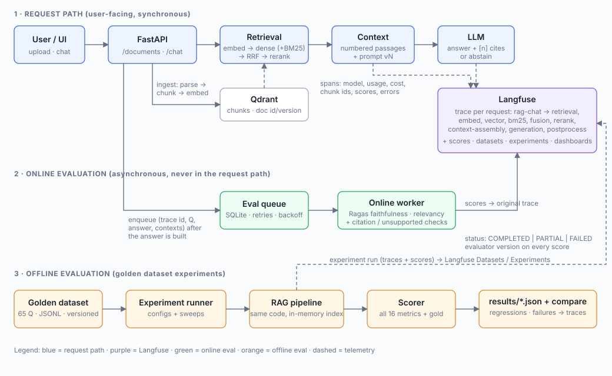

# RAG Chatbot with Langfuse Observability, Ragas Evaluation and Monitoring

A document-grounded chatbot (upload PDF / TXT / MD, ask questions, get cited answers) wrapped in a production-oriented
observability and evaluation platform:

* **Every request is a Langfuse trace**: retrieval, reranking, context assembly and generation spans with chunk ids, scores, document id/version,
  model, prompt version, token usage, estimated cost, errors and retries.
* **Online evaluation** runs *asynchronously* in a separate worker: Ragas + deterministic checks score real traces and attach the scores to them.
* **Offline evaluation**: a 65-question golden dataset, an experiment runner (configs and sweeps over chunking, top-k, hybrid search, reranking, prompts, models, embeddings),
  and a regression-aware comparison tool.
* Metrics that cannot be computed are reported as **not evaluated**, never as 0 ([docs/metrics.md](docs/metrics.md)).



> **About your existing project.** The ZIP was too large to attach, so this repository contains a complete chatbot built from scratch (FastAPI + Qdrant + OpenAI)
> with the instrumentation designed to be liftable onto your own service. See *Porting onto an existing chatbot* in [docs/architecture.md](docs/architecture.md).
> If you share `chat.py` and your RAG pipeline module, the exact edit list for your code can be produced.

## What was verified, and what was not

| Verified in a keyless sandbox | Needs your credentials to confirm |
|---|---|
| 70 automated tests pass (tracing with the **real Langfuse 5.1 SDK** and an in-memory exporter, metrics, async worker, retries, API, experiments, dataset integrity) | Calls to OpenAI (chat, embeddings) |
| All 8 Ragas 0.4.3 metrics construct against an OpenAI client | Live Ragas scoring with a real judge model |
| Offline experiments, sweeps and comparisons run end to end (fake providers) | Delivery of traces/scores to a Langfuse server, dashboards, dataset runs (`python -m scripts.verify_langfuse` checks this in one command) |

Quality numbers produced with `PROVIDER_MODE=fake` (hashing embeddings + extractive stub LLM) demonstrate the plumbing only. They say nothing about your real system.

## Quick start

Python 3.10+ (developed on 3.13).

```bash
python -m venv .venv
source .venv/bin/activate          # Windows: .venv\Scripts\activate
pip install -r requirements-dev.txt
cp .env.example .env               # Windows: copy .env.example .env
```

### A. Offline smoke test (no keys)

```bash
pytest -q                                                     # 70 tests
PROVIDER_MODE=fake python -m evaluation.experiment --no-langfuse --limit 20
```
(Windows PowerShell: `$env:PROVIDER_MODE="fake"` first.)

### B. Keyless local setup

The app starts without API credentials when `PROVIDER_MODE=fake`. This uses a deterministic extractive chat stub and local hashing embeddings, so you can test document upload, retrieval, and the UI without paid services. Answers and evaluation scores in this mode are demonstrations only, not real model quality. Set `LANGFUSE_ENABLED=false` and `ONLINE_EVAL_ENABLED=false` to keep the run fully local.

To switch to real model calls later, set `PROVIDER_MODE=openai`, configure `LLM_PROVIDER`, `LLM_API_KEY` and `LLM_BASE_URL` for the chat provider, and configure a separate `EMBEDDING_API_KEY` for embeddings. Groq chat does not provide embeddings.

### C. Real setup

1. Edit `.env`: set `PROVIDER_MODE=openai`, `LLM_API_KEY` to your Groq API key, `LLM_PROVIDER=groq`, and `LLM_BASE_URL=https://api.groq.com/openai/v1`. Set `EMBEDDING_API_KEY` to a separate API key for the embeddings service (the Groq chat endpoint does not provide embeddings). Also set the Langfuse keys (`LANGFUSE_PUBLIC_KEY`, `LANGFUSE_SECRET_KEY`, `LANGFUSE_HOST`) from a Langfuse Cloud or self-hosted project.
2. Verify the Langfuse connection end to end:
   ```bash
   python -m scripts.verify_langfuse
   ```
   It checks credentials, answers one question over the sample corpus, prints the trace URL and attaches a score.
3. Run the app and the evaluation worker (two processes):
   ```bash
   uvicorn app.main:app --port 8000          # chat UI at http://127.0.0.1:8000
   python -m evaluation.online_worker        # async online evaluation
   ```
4. Upload `evaluation/golden/corpus/security_policy.md` in the UI, ask *"How many characters long must passwords be?"*, then open **Langfuse -> Tracing**.
   Within a minute the worker attaches `faithfulness`, `answer_relevancy`, `hallucination_rate`, `citation_*`, `unsupported_claim_rate` and `online_eval_status` to that trace.

Embedded Qdrant supports only one application process per storage folder. Start the app once with one worker; a second app process using the same folder is rejected with the lock owner PID and safe recovery instructions. Do not delete Qdrant lock or storage files to work around this. If you need multiple workers, run a Qdrant server and set `QDRANT_URL`. `--reload` can also create a second process during reload, so avoid it with embedded storage.

## Configuration

Everything is an environment variable; see [`.env.example`](.env.example). Highlights:

| Variable | Purpose |
|---|---|
| `LLM_PROVIDER`, `LLM_API_KEY`, `LLM_BASE_URL`, `LLM_MODEL`, `LLM_TIMEOUT_SECONDS` | chat provider (Groq or OpenAI-compatible API) and request timeout |
| `EMBEDDING_API_KEY`, `EMBEDDING_BASE_URL`, `EMBEDDING_MODEL` | separate embeddings API credentials and model |
| `CHUNK_SIZE`, `CHUNK_OVERLAP`, `TOP_K`, `HYBRID`, `RERANKER`, `PROMPT_VERSION` | the RAG knobs that experiments vary |
| `LANGFUSE_*` | tracing; unset => the app runs normally with tracing disabled |
| `ONLINE_EVAL_SAMPLE_RATE` | fraction of production requests evaluated (controls judge cost) |
| `JUDGE_MODEL`, `JUDGE_EMBEDDING_MODEL` | Ragas judge chat and embedding models; both use the configured chat/embedding providers |
| `EVAL_MAX_ATTEMPTS`, `EVAL_RETRY_BASE_SECONDS` | online evaluation retry policy |
| `REDACT_PII` | mask emails/phones/key-like strings in traces and the eval queue |
| `PRICING_JSON` | override cost estimates per model |

No credentials are in the code; `.env` is git-ignored.

## Observability: what each trace contains

See the span tree in [docs/architecture.md](docs/architecture.md). In short: trace name `rag-chat`; tags `rag`, `prompt:<v>`, `model:<m>`; trace `version` = prompt version;
metadata with the full RAG config; `session_id`/`user_id`; retrieval output with `chunk_id`, `document_id`, `document_version`, `rank`, `score` (+ dense/BM25/rerank scores) and text;
generation with model, usage, cost and retry count; citations resolved to chunk ids; request-time scores `empty_context`, `abstained`, `invalid_citation_count`, `top_retrieval_score`;
errors recorded as level `ERROR` with status messages. Tracing never breaks a request: all Langfuse calls are guarded, and the app works identically with Langfuse unconfigured.

## Online evaluation

* The chat handler only **enqueues** a small job (SQLite, idempotent per trace). No judge call happens in the request path (a test asserts this).
* `python -m evaluation.online_worker` scores the reference-free metrics (Ragas `faithfulness`, `answer_relevancy`; `hallucination_rate`, `citation_correctness`,
  `citation_coverage`, `unsupported_claim_rate`) and attaches them to the original trace.
* **Status & errors:** `online_eval_status` = `COMPLETED` / `PARTIAL` / `FAILED` with the list of evaluated, errored and not-evaluated metrics (and why).
  Failures retry with exponential backoff up to `EVAL_MAX_ATTEMPTS`; score ids are deterministic so retries never duplicate.
* **Evaluator version:** `rag-eval/1|ragas=0.4.3|judge=<model>|emb=<model>` is stored on every score and job.
* Metrics needing gold labels are explicitly listed as not evaluated online.
* `python -m evaluation.online_worker --drain` processes what is due and exits (cron-friendly). The worker refuses to start without Langfuse credentials (it would consume jobs and discard scores); `--dry-run` scores locally for debugging.

## Offline evaluation

**Golden dataset** - `evaluation/golden/golden_dataset.jsonl`, 65 questions over a synthetic 3-document corpus (`evaluation/golden/corpus/`):

| Type | Count | Purpose |
|---|---|---|
| factual | 14 | single-fact descriptive answers |
| exact_match | 18 | numbers / short literals where exactness matters |
| multi_hop | 13 | combine 2+ passages, sometimes with arithmetic |
| ambiguous | 8 | underspecified; expected: cover all readings or ask to clarify |
| unanswerable | 12 | not in the documents; expected: abstain |

Each row has `reference_answer`, verbatim `reference_contexts`, `answerable`, `expected_behavior` and `source_documents`. A test verifies every gold passage is verbatim corpus text
and that the JSONL matches its generator (`evaluation/golden/build_golden.py`). **Replace the corpus and questions with your own documents** for meaningful numbers: add files to `corpus/`,
edit `build_golden.py` (keys resolve to exact lines), run `python -m evaluation.golden.build_golden`, or pass `--golden` / point the runner at your own corpus.

```bash
# 1. baseline
python -m evaluation.experiment --config evaluation/configs/baseline.json
# 2. sweep (every combination is its own run): chunking x top-k x hybrid search
python -m evaluation.experiment --config evaluation/configs/baseline.json \
    --sweep chunk_size=400,800 --sweep top_k=3,5 --sweep hybrid=false,true
# 3. compare two runs
python -m evaluation.compare evaluation/results/<baseline>.json evaluation/results/<candidate>.json --fail-on-regression
```

Sweepable keys: `chunk_size`, `chunk_overlap`, `top_k`, `hybrid`, `reranker` (`none|lexical`), `prompt_version` (add `v3` in `app/prompts.py`), `llm_model`, `embedding_model`,
`temperature`, `candidate_multiplier`. Each configuration rebuilds its own in-memory index, so changing chunking or embeddings is a fair comparison.

To record runs in Langfuse (Datasets -> Runs side by side):
```bash
python -m scripts.sync_golden_dataset              # once, and after dataset changes
python -m evaluation.experiment --dataset-name rag-golden-v1 --config evaluation/configs/baseline.json
```

Each report (`evaluation/results/*.json`) contains aggregates (mean, evaluated / not-evaluated / error counts), per-question-type means, latency p50/p95, estimated cost, the evaluator and dataset
versions, per-item scores with trace URLs, and a `failures` list.

## Continuous improvement loop

**Baseline -> identify failures -> inspect traces -> improve -> rerun -> compare**

1. `python -m evaluation.experiment` - baseline report.
2. Open `failures` in the report (each item has `failure_reasons`: wrong abstain/answer decision, low faithfulness or correctness, gold passage not retrieved, unsupported citations) or the run in Langfuse.
3. Inspect the item's trace: was the gold passage retrieved (`retrieval` output)? ranked low (`rank-fusion`/`rerank`)? dropped by the context budget (`context-assembly`)? ignored by the model (`generation`)?
   - *gold passage missing* -> retrieval problem: `chunk_size`/`chunk_overlap`, `top_k`, `hybrid=true`, `reranker`, embedding model.
   - *retrieved but answer wrong or unfaithful* -> prompt/model problem: new prompt version, stronger LLM.
   - *answered when it should abstain* -> prompt rules for abstention, retrieval threshold.
4. Change one thing, rerun (`--sweep` for grids), then `python -m evaluation.compare`.
   Compare is direction-aware (e.g. a rise in `hallucination_rate` is a regression), warns if dataset/evaluator versions differ, and lists items that got worse.
5. Gate changes in CI with `--fail-on-regression`. No fine-tuning is involved or needed until retrieval and prompt options are exhausted.

## Monitoring dashboards

[docs/dashboards.md](docs/dashboards.md) gives widget-by-widget recipes for two separate dashboards:
**Infrastructure** (latency p50/p95, stage latency, error rate, token usage, cost, eval-queue health) and **RAG quality** (faithfulness, answer relevancy, hallucination,
citation quality, empty-context and abstention rate, user feedback, quality by prompt version/model, evaluation coverage), plus how to read them together.

## Metrics

[docs/metrics.md](docs/metrics.md) has the full table of all 16 metrics with required inputs, judge/embedding needs, online/offline availability and the rules that produce *not evaluated*.

## Tests

```bash
pytest -q                           # 70 tests, ~15 s, no network or keys
pytest tests/test_tracing.py -v     # trace generation with the real Langfuse SDK
```

| File | Demonstrates |
|---|---|
| `test_tracing.py` | full span tree per request, model/usage/cost, chunk ids and versions, citations, request scores, errors on spans, PII masking, works without Langfuse |
| `test_online_eval.py` | queue semantics, scores attached to the original trace, evaluator version, retries with idempotent ids, PARTIAL/FAILED status, no judge call in the request path, sampling, redacted payloads |
| `test_metrics.py` | input requirements, not-evaluated (never zero), errors, hallucination derivation, deterministic metric behaviour |
| `test_experiments.py` | sweeps, end-to-end run, Langfuse experiment path, direction-aware comparison |
| `test_api.py` | upload (MD + real PDF) -> chat -> cited answer + trace id, abstention, empty index, delete, validation, 502 on provider failure, feedback |
| `test_golden_dataset.py`, `test_chunking.py` | dataset integrity and chunker properties |

## Compatibility notes

* **Versions tested:** Python 3.13, `langfuse 5.1.0`, `ragas 0.4.3`, `openai 1.109.1`, `qdrant-client 1.20.0`, `langchain-community 0.3.31` (`requirements.lock.txt` has the full freeze).
* **Ragas 0.4.3 vs langchain-community 0.4.x:** `import ragas` fails with `ModuleNotFoundError: langchain_community.chat_models.vertexai` on langchain-community 0.4.x.
  `requirements.txt` pins `langchain-community>=0.3.31,<0.4`. Drop the pin once Ragas removes that import.
* **Langfuse 5.x** is the OpenTelemetry-based SDK: `start_as_current_observation`, `propagate_attributes`, `create_score`, `run_experiment`. Older v2 code (`langfuse.trace()`, `@observe` with `langfuse_context`) is not compatible.
* **Ragas 0.4 metrics** are the `ragas.metrics.collections` classes with `ascore(...)`; the legacy `ragas.evaluate()` + `SingleTurnSample` flow is not used.
* The OpenAI client is pinned `<2` as tested; newer major versions were not exercised.

## Known limitations

* The sample corpus and golden dataset are synthetic and small; use your own documents for decisions.
* `reranker=lexical` is a lightweight term-overlap reranker, not a cross-encoder. Add a model-based reranker behind the same interface in `app/retriever.py`.
* BM25 is rebuilt in memory from Qdrant when the index changes; fine for thousands of chunks, not millions.
* The eval queue is SQLite (single host). For multi-host deployments, implement the same four methods on Redis/SQS.
* Embedded Qdrant is single-process; the app holds an OS-level guard for the storage lifetime. Use `QDRANT_URL` with a Qdrant server for multiple workers or app instances.
* Ingestion runs as a FastAPI background task (no separate worker); long PDFs block a worker thread. The API has no authentication or rate limiting - put it behind your gateway.
* `citation_correctness` and `unsupported_claim_rate` are lexical heuristics (documented as such); LLM-judged Ragas metrics are the primary signal.
* Costs shown are estimates from `PRICING_JSON`/defaults and Langfuse model pricing; verify against your provider's invoice.
# Rag-observability-

