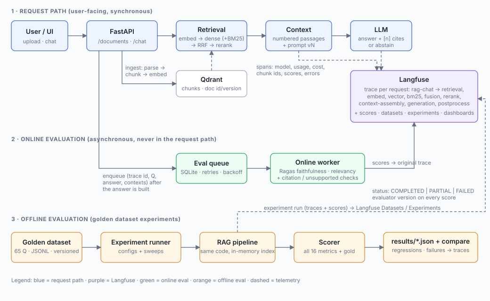

# Architecture and file guide



## Request path (synchronous)

```
POST /api/v1/chat
 -> RAGPipeline.answer()                                   app/rag.py
     rag-chat (chain)                                      <- one Langfuse trace per request
      |- retrieval (retriever)                             app/retriever.py
      |    |- embed-query (embedding)   model, tokens, cost
      |    |- vector-search             Qdrant dense top-k*N
      |    |- bm25-search               (hybrid only)
      |    |- rank-fusion               (hybrid only, reciprocal-rank fusion)
      |    |- rerank                    (reranker != none)
      |- context-assembly (span)        numbered passages within MAX_CONTEXT_CHARS
      |- generation (generation)        model, prompt version, usage, cost, retries
      |- answer-postprocess (span)      citations -> chunk ids, invalid citations, abstention
 -> request-time scores: empty_context, abstained, invalid_citation_count, top_retrieval_score
 -> enqueue (trace_id, question, answer, contexts) to the eval queue     <- the only evaluation work in the request path
```

If retrieval returns nothing the LLM is **not** called; the pipeline abstains and records `empty_context = 1`.

## Online evaluation (asynchronous)

```
python -m evaluation.online_worker
  claim job -> build Sample -> Scorer.score(online=True)
            -> create_score(trace_id=<original trace>, deterministic score_id) per evaluated metric
            -> online_eval_status = COMPLETED | PARTIAL | FAILED (+ not-evaluated reasons, evaluator version)
  metric error -> job returns to the queue with exponential backoff (EVAL_RETRY_BASE_SECONDS * 2^(attempt-1))
  after EVAL_MAX_ATTEMPTS -> job FAILED, terminal status published once
```

Score ids are hashes of `(trace_id, metric, evaluator_version)`, so a retry upserts instead of duplicating, and a *new* evaluator version adds a separate score instead of overwriting history.

## Offline evaluation

```
python -m evaluation.experiment --config <json> [--sweep key=v1,v2 ...]
  per config: fresh in-memory Qdrant index (chunking/embeddings change the index) -> RAGPipeline (same code as production)
  per item  : answer -> Scorer.score(all metrics, with gold labels)
  Langfuse configured : langfuse.run_experiment / dataset.run_experiment (traces linked to the run, item scores, run-level means)
  always              : evaluation/results/<run>.json (aggregates, per-type means, per-item scores, failures, latency/cost)
python -m evaluation.compare A.json B.json   -> deltas, regressions (direction-aware), items that got worse
```

## Files

| File | Role |
|---|---|
| `app/main.py` | FastAPI app: upload/list/delete documents, chat, feedback, health; UI at `/` |
| `app/config.py` | All settings from environment variables (`.env`); cost estimation |
| `app/observability.py` | Langfuse client factory, failure-proof `observation()` / `trace_attributes()` / `create_score()` helpers; no-op when unconfigured |
| `app/privacy.py` | PII/secret redaction used as the Langfuse `mask` function and before queueing |
| `app/ingestion.py` | parse (PDF/TXT/MD) -> chunk -> embed -> upsert; document registry; ingestion is traced |
| `app/chunking.py` | line/sentence-aware chunker with overlap |
| `app/embeddings.py` | OpenAI embeddings + offline hashing embedder (tests only) |
| `app/vectorstore.py` | Qdrant wrapper (dense search, delete by document, BM25 index for hybrid) |
| `app/retriever.py` | dense / hybrid (RRF) / lexical rerank, each stage a span |
| `app/prompts.py` | versioned prompts (`v1`, `v2`), abstention detection |
| `app/llm.py` | OpenAI chat client with visible retries; offline extractive FakeChat |
| `app/rag.py` | **the pipeline and all request-path instrumentation** |
| `evaluation/metrics.py` | metric registry: required inputs, applicability, `not_evaluated` rules, evaluator schema version |
| `evaluation/deterministic.py` | citation, unsupported-claim, abstention and gold-retrieval metrics (no LLM) |
| `evaluation/ragas_backend.py` | Ragas 0.4 metric construction and invocation; LLM-judged completeness |
| `evaluation/scoring.py` | applies the registry to a sample; error/not-evaluated handling |
| `evaluation/eval_queue.py` | durable SQLite job queue (retries, backoff, stale-job recovery) |
| `evaluation/online_worker.py` | async worker that scores queued traces and attaches scores to Langfuse |
| `evaluation/experiment.py` | offline runner, config loading, sweeps, reports |
| `evaluation/compare.py` | run comparison and regression gate |
| `evaluation/golden/` | corpus, `build_golden.py`, `golden_dataset.jsonl` |
| `evaluation/configs/` | example experiment configs |
| `scripts/sync_golden_dataset.py` | upload the golden set to Langfuse as a dataset |
| `scripts/verify_langfuse.py` | live check: auth, one traced question, one score |
| `tests/` | 70 tests: tracing (real SDK, in-memory exporter), metrics, online worker, API, experiments, golden-data integrity |
| `static/index.html` | minimal upload + chat UI |

## Porting onto an existing chatbot

The observability and evaluation layers do not depend on the sample pipeline. To wrap an existing RAG service:

1. Copy `app/observability.py`, `app/privacy.py`, `evaluation/` and the config entries.
2. In your request handler, mirror the span structure from `app/rag.py`: one root `observation("rag-chat", as_type="chain")` wrapped in `trace_attributes(...)`, then `retriever`, `span` and `generation` observations around your retrieval, context building and LLM call. Record chunk ids, scores, document id/version, model, usage.
3. After building the answer, call `eval_queue.enqueue(trace_id, {question, answer, contexts, ...})`.
4. Run `python -m evaluation.online_worker` as its own process.
5. For experiments, replace `build_pipeline()` in `evaluation/experiment.py` with a factory for your pipeline (it only needs `.answer(question, ...) -> RAGResult`-like output: answer, contexts, abstained, cited numbers).
6. If you already run Redis (as in a Redis-queue ingestion setup), implement the four `EvalQueue` methods (`enqueue`, `claim`, `complete`, `fail`) on Redis; the worker does not care.
